# Mini-Zendesk Entity-Relationship Diagram (ERD)

This document visualizes and describes the complete relational database architecture for the **Mini-Zendesk** support ticketing system.

---

## 📊 Visual ERD (Mermaid)

```mermaid
erDiagram
    CLIENTS ||--o{ TICKETS : "files (client_id)"
    AGENTS ||--o{ TICKETS : "assigned to (agent_id)"
    TICKETS ||--o{ MESSAGES : "contains (ticket_id)"
    TICKETS ||--o{ WORKSHEET : "tracked in (ticket_id)"
    AGENTS ||--o{ WORKSHEET : "assigned to (agent_id)"
    TICKETS ||--o{ AUDIT : "logged in (ticket_id)"
    CLIENTS ||--o{ SESSIONS : "authenticates (user_type=client)"
    AGENTS ||--o{ SESSIONS : "authenticates (user_type=agent)"

    CLIENTS {
        int id PK "Auto Increment"
        string name "Company / Organization"
        string email UK "Unique Login"
        string password_hash "Encrypted Password"
        timestamp created_at "Registration time"
    }

    CUSTOMERS {
        int id PK "Auto Increment"
        string name "End User Name"
        string email UK "Unique Login"
        string password_hash "Encrypted Password"
        timestamp created_at "Registration time"
    }

    AGENTS {
        int id PK "Auto Increment"
        string name "Support Staff Name"
        string email UK "Unique Login"
        string role "admin | agent"
        string password_hash "Encrypted Password"
        int is_active "1=Active, 0=Disabled"
        timestamp created_at "Registration time"
    }

    USERS {
        int id PK "Auto Increment"
        string name "Internal User Name"
        string category "Department / Role"
        string password_hash "Encrypted Password"
        timestamp created_at "Registration time"
    }

    STATUSES {
        int id PK "Auto Increment"
        string name UK "open, pending, solved, closed, sla_breached, escalated"
    }

    PRIORITIES {
        int id PK "Auto Increment"
        string name UK "low (48h), normal (24h), high (4h), urgent (1h)"
    }

    TICKETS {
        int id PK "Auto Increment"
        string title "Subject"
        string description "Issue details"
        string status "open, pending, solved, closed, etc."
        string priority "low, normal, high, urgent"
        int client_id FK "References CLIENTS.id"
        int agent_id FK "References AGENTS.id (Nullable)"
        int is_escalated "0=Normal, 1=Escalated"
        string attachment_path "Nullable path"
        timestamp due_at "SLA Target Deadline"
        timestamp solved_at "Nullable resolution timestamp"
        timestamp created_at "Creation timestamp"
        timestamp updated_at "Last mutation timestamp"
    }

    MESSAGES {
        int id PK "Auto Increment"
        int ticket_id FK "References TICKETS.id (Cascade)"
        int sender_id "Polymorphic Sender ID"
        string sender_type "client | agent | admin | user"
        string text "Message content"
        string visibility "public | internal"
        timestamp created_at "Ordered chronologically"
    }

    WORKSHEET {
        int id PK "Auto Increment"
        int ticket_id FK "References TICKETS.id (Cascade)"
        int agent_id FK "References AGENTS.id"
        int assigned_by FK "References AGENTS.id"
        string reason "round_robin | manual_reassign | escalation"
        string status "Ticket status at handoff"
        timestamp created_at "Handoff timestamp"
    }

    AUDIT {
        int id PK "Auto Increment (Immutable)"
        int ticket_id FK "References TICKETS.id (Cascade)"
        string actor_type "client | agent | admin | system"
        int actor_id "Actor ID (Nullable for system)"
        string action "created | assigned | status_change | escalated"
        string old_value "Nullable state before mutation"
        string new_value "Nullable state after mutation"
        timestamp created_at "Event timestamp"
    }

    SESSIONS {
        int id PK "Auto Increment"
        string token_hash UK "SHA-256 of Bearer Token"
        string user_type "client | agent"
        int user_id "Polymorphic ID (clients.id or agents.id)"
        timestamp created_at "Login time"
        timestamp expires_at "Login time + 8 hours"
        timestamp revoked_at "Nullable (Set on logout)"
    }

    SYSTEM_SETTINGS {
        string key PK "Configuration Key"
        string value "Configuration Value"
    }
```

---

## 🔗 Key Relationships & Relational Design

### 1. Tickets $\leftrightarrow$ Clients & Agents
* **`CLIENTS` (1) $\rightarrow$ `TICKETS` (N):** Every ticket must be created by a valid client (`client_id` with `FOREIGN KEY ... ON DELETE RESTRICT`).
* **`AGENTS` (1) $\rightarrow$ `TICKETS` (N):** Tickets are assigned to support agents (`agent_id` with `FOREIGN KEY ... ON DELETE SET NULL`). `agent_id` is nullable to cleanly represent unassigned tickets in the incoming queue.

### 2. Threaded Messages (`TICKETS` $\rightarrow$ `MESSAGES`)
* **`TICKETS` (1) $\rightarrow$ `MESSAGES` (N):** A ticket contains an ordered stream of back-and-forth messages (`ticket_id` with `ON DELETE CASCADE`).
* **Polymorphic Sender:** Uses composite `(sender_id, sender_type)` to identify whether the author is a Client, Agent, or Admin without identity collisions.
* **Indexed Ordering:** Indexed on `(ticket_id, created_at ASC, id ASC)` to guarantee lightning-fast conversation rendering.

### 3. Queue & Assignment History (`TICKETS` $\rightarrow$ `WORKSHEET`)
* **Append-Only Assignment Queue:** Rather than overwriting assignments destructively, every assignment change appends a row to `WORKSHEET`.
* Tracks `assigned_by`, `reason` (`'round_robin'`, `'manual_reassign'`, `'escalation'`), and `status` at the moment of assignment, enabling live agent workload calculations.

### 4. Append-Only Audit Trail (`TICKETS` $\rightarrow$ `AUDIT`)
* **Complete Event Sourcing:** Logs every ticket creation, status transition, agent reassignment, and SLA escalation with `old_value` $\rightarrow$ `new_value` diffs.
* **System Actors:** Automatically records `actor_type = 'system'`, `actor_id = NULL` for automated background jobs (such as SLA escalation).

### 5. Token Authentication Sessions (`SESSIONS`)
* **Hashed Storage:** Stores only the SHA-256 `token_hash` of the bearer token; raw tokens are never persisted in the database.
* **Polymorphic Link:** Authenticates both Clients and Agents (including Admins) via `user_type` and `user_id`.
* **State Invalidation:** Fast verification via `token_hash` where `revoked_at IS NULL AND expires_at > NOW`.
