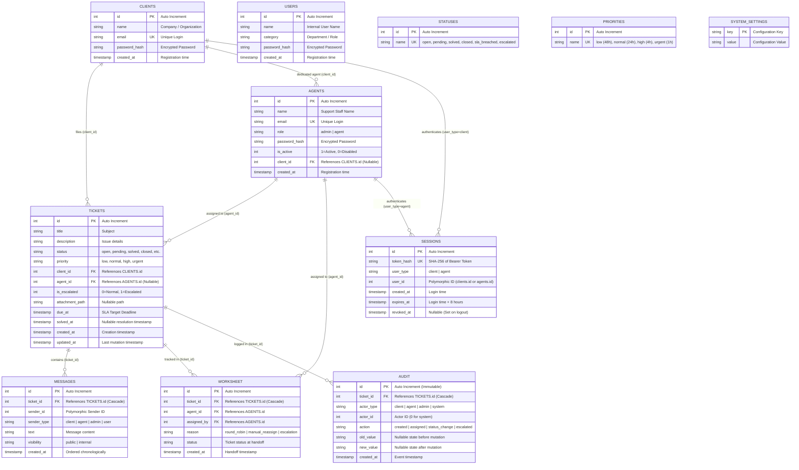
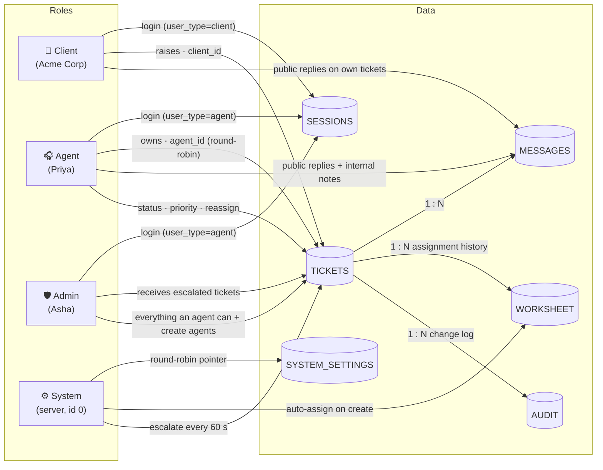
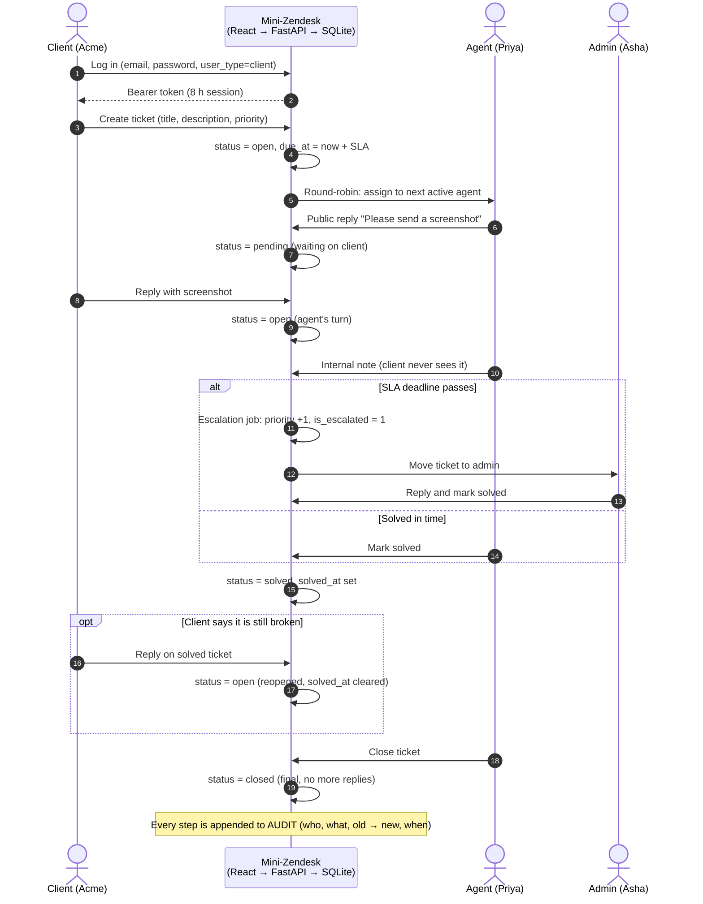
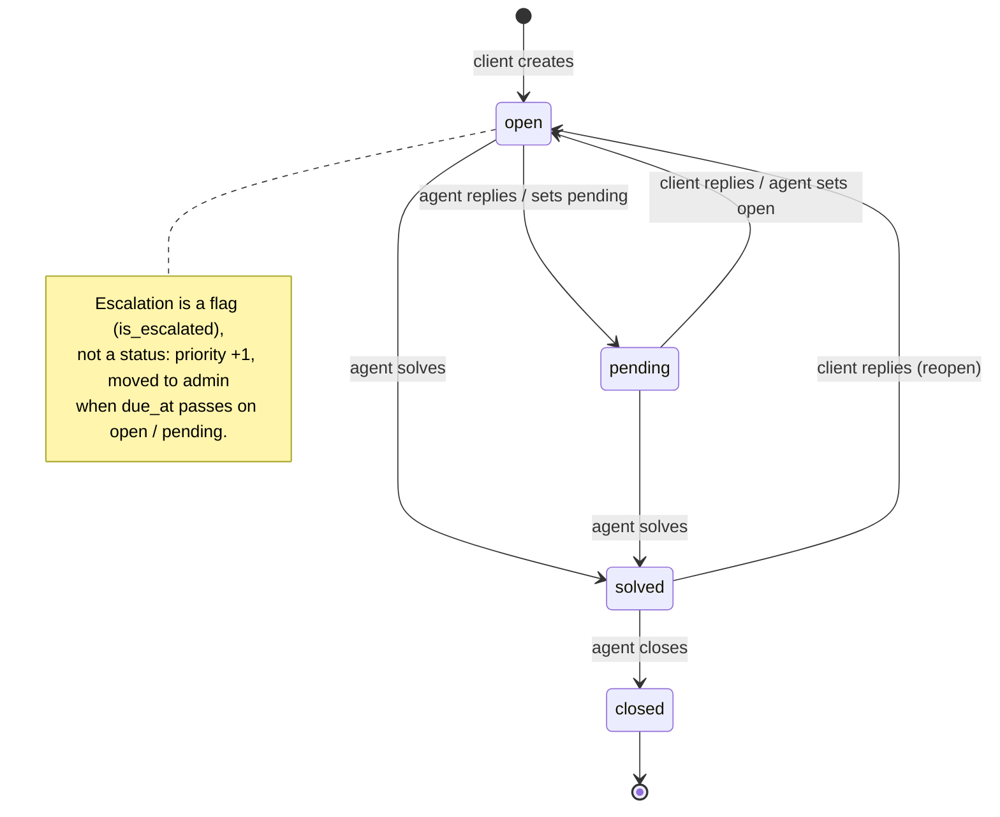

# Mini-Zendesk Entity-Relationship Diagram (ERD)

This document visualizes and describes the complete relational database architecture for the **Mini-Zendesk** support ticketing system.

---

## 📊 Visual ERD (Mermaid)

---

## 🔗 Key Relationships & Relational Design

### 1. Tickets $\leftrightarrow$ Clients & Agents
* **`CLIENTS` (1) $\rightarrow$ `TICKETS` (N):** Every ticket must be created by a valid client (`client_id` with `FOREIGN KEY ... ON DELETE RESTRICT`).
* **`AGENTS` (1) $\rightarrow$ `TICKETS` (N):** Tickets are assigned to support agents (`agent_id` with `FOREIGN KEY ... ON DELETE SET NULL`). `agent_id` is nullable to cleanly represent unassigned tickets in the incoming queue.
* **`CLIENTS` (1) $\rightarrow$ `AGENTS` (N):** An agent can have a dedicated primary client assigned via `client_id` (`FOREIGN KEY ... ON DELETE SET NULL`). Nullable for general/global pool agents.

### 2. Threaded Messages (`TICKETS` $\rightarrow$ `MESSAGES`)
* **`TICKETS` (1) $\rightarrow$ `MESSAGES` (N):** A ticket contains an ordered stream of back-and-forth messages (`ticket_id` with `ON DELETE CASCADE`).
* **Polymorphic Sender:** Uses composite `(sender_id, sender_type)` to identify whether the author is a Client, Agent, or Admin without identity collisions.
* **Indexed Ordering:** Indexed on `(ticket_id, created_at ASC, id ASC)` to guarantee lightning-fast conversation rendering.

### 3. Queue & Assignment History (`TICKETS` $\rightarrow$ `WORKSHEET`)
* **Append-Only Assignment Queue:** Rather than overwriting assignments destructively, every assignment change appends a row to `WORKSHEET`.
* Tracks `assigned_by`, `reason` (`'round_robin'`, `'manual_reassign'`, `'escalation'`), and `status` at the moment of assignment, enabling live agent workload calculations.

### 4. Append-Only Audit Trail (`TICKETS` $\rightarrow$ `AUDIT`)
* **Complete Event Sourcing:** Logs every ticket creation, status transition, agent reassignment, and SLA escalation with `old_value` $\rightarrow$ `new_value` diffs.
* **System Actors:** Automatically records `actor_type = 'system'`, `actor_id = 0` for automated background jobs (round-robin assignment and SLA escalation), because `actor_id` is `NOT NULL`.

### 5. Token Authentication Sessions (`SESSIONS`)
* **Hashed Storage:** Stores only the SHA-256 `token_hash` of the bearer token; raw tokens are never persisted in the database.
* **Polymorphic Link:** Authenticates both Clients and Agents (including Admins) via `user_type` and `user_id`.
* **State Invalidation:** Fast verification via `token_hash` where `revoked_at IS NULL AND expires_at > NOW`.

---

## 👥 Role Associations

How each role connects to the data. A **client** raises tickets, an **agent** owns them, an **admin** receives escalations, and the **system** assigns and escalates automatically.

### Role permissions

| Action | Client | Agent | Admin | System |
|---|:---:|:---:|:---:|:---:|
| Log in | ✅ | ✅ | ✅ | — |
| See tickets | own only | all | all | — |
| Create ticket | ✅ | ❌ | ❌ | — |
| Public reply | ✅ own | ✅ | ✅ | — |
| Internal note | ❌ | ✅ | ✅ | — |
| Change status | ❌ | ✅ | ✅ | — |
| Change priority | ❌ | ✅ | ✅ | ✅ escalation |
| Assign / reassign | ❌ | ✅ | ✅ | ✅ round-robin |
| Receives tickets | — | round-robin | escalations | — |
| Audit trail & daily report | ❌ | ✅ | ✅ | — |
| Create agents | ❌ | ❌ | ✅ | — |
| Run escalation | ❌ | ❌ | ✅ | ✅ every 60 s |

Enforced in `backend-controller/deps.py` (`require_staff`, `require_admin`). A client requesting another client's ticket gets **404**, so the API never reveals that it exists.

---

## 🔄 User Flow

One ticket from creation to close, showing who does what and how Mini-Zendesk reacts.

### Ticket lifecycle

Any move not shown is rejected with **400**. A reply on a closed ticket is rejected as well.
