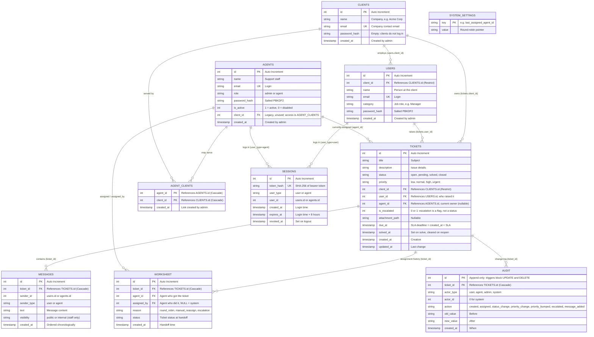
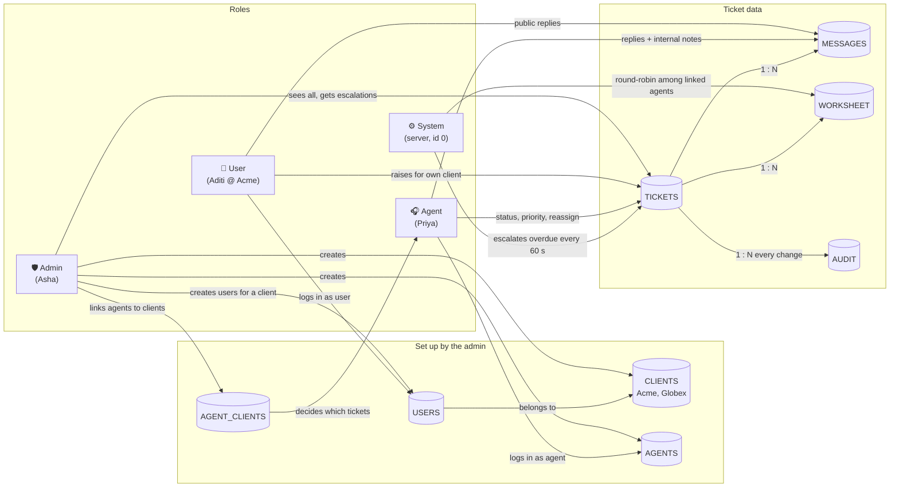
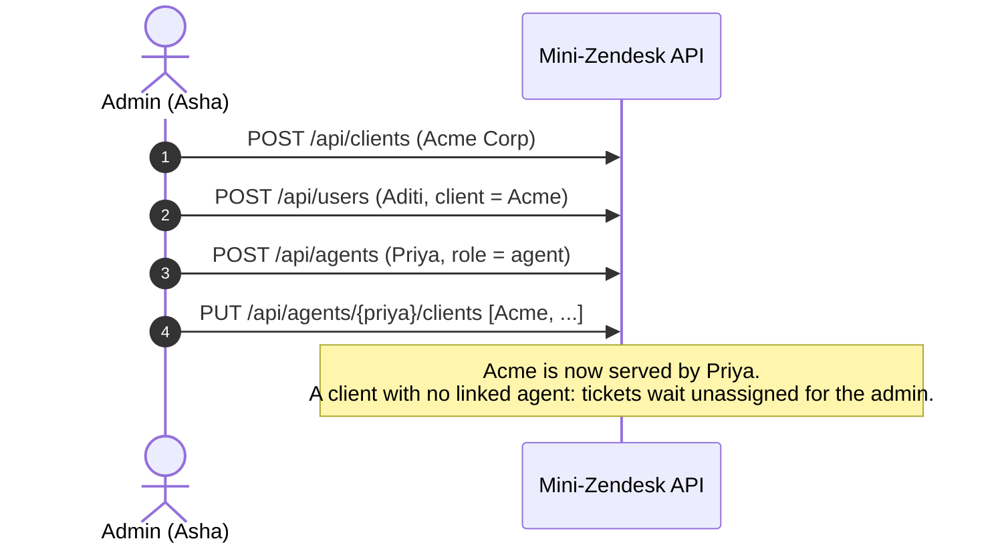

# Mini-Zendesk Entity-Relationship Diagram (ERD)

This document visualizes and describes the relational database architecture and the user flows of the **Mini-Zendesk** support ticketing system. It matches `backend/schema.sql` and the API in `backend-controller/`.

**The model in one line:** the **admin** sets everything up (clients, their users, agents, and which agents serve which client); **users** of a client raise tickets; **agents** linked to that client solve them; the **system** assigns and escalates automatically. Clients are companies and do not log in.

---

## 📊 Visual ERD (Mermaid)



`statuses` and `priorities` lookup tables also exist in the schema; the API uses the fixed lists in `backend-controller/constants.py`.

---

## 🔗 Key Relationships & Relational Design

### 1. Clients, users and tickets
* **`CLIENTS` (1) → `USERS` (N):** every user belongs to exactly one client (`users.client_id`, `ON DELETE RESTRICT`).
* **`CLIENTS` (1) → `TICKETS` (N):** a ticket belongs to the client of the user who raised it; colleagues at the same client can see it too.
* **`USERS` (1) → `TICKETS` (N):** `tickets.user_id` records who raised it.

### 2. Agent ↔ client access (`AGENT_CLIENTS`)
* **Many-to-many:** an agent can serve many clients, a client can have many agents. Only the admin changes it (`PUT /api/agents/{id}/clients`).
* An agent sees and works only on tickets of linked clients; anything else is **404**. Admins see everything.
* Round-robin and manual reassign only pick agents linked to the ticket's client. No linked agent → the ticket stays unassigned for the admin.
* `agents.client_id` is a leftover column; the API does not use it.

### 3. Threaded messages (`TICKETS` → `MESSAGES`)
* Ordered back-and-forth, indexed on `(ticket_id, created_at, id)`.
* `(sender_type, sender_id)` says whether a user or an agent wrote it. Internal notes are never shown to users.

### 4. Assignment history (`TICKETS` → `WORKSHEET`)
* The current owner is `tickets.agent_id`; every assignment also appends a `WORKSHEET` row with `reason` and `assigned_by` (NULL = system).

### 5. Append-only audit trail (`TICKETS` → `AUDIT`)
* Every change is written in the **same transaction** as the change itself; if the audit insert fails, the change rolls back.
* SQLite triggers `audit_no_update` / `audit_no_delete` abort any UPDATE or DELETE.
* System actions (round-robin, escalation) use `actor_type = 'system'`, `actor_id = 0`.

### 6. Sessions
* Only the SHA-256 hash of the token is stored; tokens expire after 8 hours and logout revokes them.
* `user_type` is `user` or `agent` (admins are agents with `role = 'admin'`).
* 5 wrong passwords for an account → **429** for 15 minutes.

---

## 👥 Role Associations

How each role connects to the data. The **admin** sets up clients, users, agents and access; **users** raise tickets for their client; **agents** work on their linked clients' tickets; the **system** assigns and escalates automatically.



### Role permissions

| Action | User | Agent | Admin | System |
|---|:---:|:---:|:---:|:---:|
| Log in | ✅ (`user`) | ✅ (`agent`) | ✅ (`agent`) | — |
| Create clients, users, agents | ❌ | ❌ | ✅ | — |
| Link agents to clients | ❌ | ❌ | ✅ | — |
| See tickets | own client's | linked clients' | all | — |
| Create ticket | ✅ | ❌ | ❌ | — |
| Public reply | ✅ | ✅ | ✅ | — |
| Internal note | ❌ | ✅ | ✅ | — |
| Change status | ❌ | ✅ | ✅ | — |
| Change priority | ❌ | ✅ | ✅ | ✅ when SLA breached |
| Assign / reassign | ❌ | ✅ linked agents only | ✅ linked agents only | ✅ round-robin |
| Receives tickets | — | round-robin | escalations | — |
| Audit trail | ❌ | ✅ linked clients only | ✅ all | — |
| Daily report | ❌ | ✅ (company-wide numbers) | ✅ | — |
| Run escalation now | ❌ | ❌ | ✅ | ✅ every 60 s |

Enforced in `backend-controller/deps.py` (`require_staff`, `require_admin`) and `scope_client_ids` / `get_or_404` in `controllers/tickets.py`. A ticket outside your scope returns **404**, so the API never reveals that it exists.

---

## 🛠️ Setup Flow (admin)

What has to exist before a user can raise a ticket.



---

## 🔄 User Flow

One ticket from creation to close, showing who does what and how Mini-Zendesk reacts.

```mermaid
sequenceDiagram
    autonumber
    actor U as User (Aditi @ Acme)
    participant MZ as Mini-Zendesk<br/>(React → FastAPI → SQLite)
    actor A as Agent (Priya, linked to Acme)
    actor AD as Admin (Asha)

    U->>MZ: Log in (email, password, user_type = user)
    MZ-->>U: Bearer token (8 h); 5 wrong passwords = 429 for 15 min
    U->>MZ: Create ticket (title, description, priority)
    MZ->>MZ: status = open, due_at = now + SLA
    MZ->>A: Round-robin among agents linked to Acme
    A->>MZ: Public reply "Can you share the transaction ID?"
    MZ->>MZ: status = pending (waiting on the user)
    U->>MZ: Reply "TXN-12345"
    MZ->>MZ: status = open (agent's turn)
    A->>MZ: Internal note (the user never sees it)

    alt SLA deadline passes
        MZ->>MZ: Escalation job: priority +1, is_escalated = 1
        MZ->>AD: Move ticket to admin
        AD->>MZ: Reply and mark solved
    else Solved in time
        A->>MZ: Mark solved
    end
    MZ->>MZ: status = solved, solved_at set

    opt User says it is still broken
        U->>MZ: Reply on solved ticket
        MZ->>MZ: status = open (reopened, solved_at cleared)
    end

    A->>MZ: Close ticket
    MZ->>MZ: status = closed (final, no more replies)
    Note over MZ: Every step is one AUDIT row: who, what, old → new, when
```

### Ticket lifecycle


Any move not shown is rejected with **400**. A reply on a closed ticket is rejected as well. If two agents change the same ticket at the same moment, the second gets a clear **400** (the read, rule check and write run in one locked transaction).

### Audit trail of the flow above

| Actor | action | old → new |
|---|---|---|
| Aditi (user) | `created` | → open |
| System (0) | `assigned` | → Priya Agent (2) |
| Priya (agent) | `message_added` | → public |
| Priya (agent) | `status_change` | open → pending |
| Aditi (user) | `message_added` | → public |
| Aditi (user) | `status_change` | pending → open |
| Priya (agent) | `message_added` | → internal |
| System (0) | `priority_bumped` | high → urgent |
| System (0) | `escalated` | Priya Agent (2) → Admin Asha (1) |
| Asha (admin) | `status_change` | open → solved |
